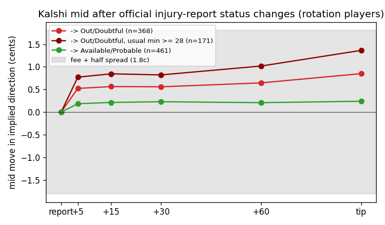

# Edge scan: injury reports, trade timing, player-prop data (go / no-go)

Kalshi game-winner quotes (1-minute, `data/frozen/prices.parquet`), test window 1 Feb – 12 Apr 2026 (Dec–Jan used to tune
in 3b). CLV = the side's Kalshi mid at tip minus the price paid at the touch, **after the 0.07·p·(1−p) fee**, per
contract. CIs are 95% game-day block bootstrap (2,000 draws). $0 LLM spend.

| Part | Verdict | Key number | 95% CI | n |
|---|---|---|---|---|
| 3a Official injury reports → Kalshi | **No-go** | mean CLV after fees, buying at report + 5 min after a rotation player goes → Out/Doubtful: **−1.42¢** | [−1.70, −1.14] | 368 changes, 63 days |
| 3b Trade timing (anchor agent) | **No-go** | best out-of-sample rule, "follow a ≥15¢ move since the 24 h anchor": **−0.67¢**; the anchor's own fills: −1.76¢ | [−1.29, −0.10]; [−2.06, −1.43] | 20; 129 |
| 3c Player-prop history | **Go** | Kalshi `KXNBAPTS`, Dec–Apr: **18,837 settled player-points markets over 924 games**, 1-minute bid/ask candles in 12 of 12 sampled markets | – | 18,837 |

## 3a Official NBA injury reports

- I parsed 2,631 official injury-report PDFs from 31 Jan to 12 Apr into 253k (report time, team, player, status) rows. The parser uses pypdf text coordinates and runs in about 3 minutes across 6 processes. From those rows I found 4,640 status changes between consecutive reports, of which 2,149 involve rotation players (usual minutes ≥ 20 in 2025-26) and 2,129 have Kalshi quotes. Each change is mapped to the team's next tip within 36 hours.
- **The market barely moves after the report, and most of that small move happens within 5 minutes.** For → Out/Doubtful changes, the mid moves in the implied direction by +0.51¢ at +5 min, +0.56¢ at +30 min, +0.63¢ at +60 min and +0.83¢ at tip. The move still available after report + 5 min is **+0.32¢ [+0.06, +0.57]**, against **1.75¢ of fee plus half-spread**. For stars (usual minutes ≥ 28, n = 171) it is +0.57¢ [+0.21, +1.02], but these players' prices had already drifted +1.8¢ in the hour *before* the report. Only 20% of changes have positive CLV after fees (74 / 368).
- The median lead over the ESPN inactive list (tip − 30 min) is 60 min for → Out/Doubtful changes and about 5 h across all changes. So the lead time exists, but the price signal is too small to trade. Explicit → Available/Probable changes give −1.72¢ [−1.99, −1.46] (n = 461).
- Caveats:
  - The magnitude of each change comes from the player's usual minutes, not from M4. I didn't wire up `Forecaster.win(out=…)` because it needs a replay view.
  - Report time is the time stamped on the PDF; the actual publication can be a few minutes later, which would make the result *worse*.
  - Players dropping off the report ("removed") are noisy and are kept out of the headline numbers.

## 3b Trade timing

- Data: the anchor agent's decision points with their model − market gap (`runs/quick_wins/prefilter_*`: 630 points in Dec–Jan for tuning and 771 in Feb–Apr for testing), plus the published fixed4 fills (`shift_fixed4_empty`, 129 fills).
- **CLV before costs (mid to mid) is about 0 in every bucket**: trades +0.01¢ [−0.24, +0.27] and anchor fills +0.16¢ [−0.14, +0.50]. After costs, every bucket is around −2¢, with the CI below 0:
  - 0–30 min before tip: −1.65¢
  - 30–60 min before tip: −1.84¢
  - With ESPN news vs without: −1.94¢ vs −1.93¢
  - Entering 5, 10 or 20 min after the trigger: −1.99 / −2.05 / −2.01¢
- The news-age and "first price after news" tests are degenerate. The anchor only decides at tip − 60 and tip − 30, and the only news in the frozen data is the ESPN inactive list published at tip − 30, so the first price after news *is* the trigger price (difference 0.00).
- The 24 h-anchor mean-reversion check (decisions at tip − 120/−60/−30 for every game, thresholds tuned on Dec–Jan) shows **fading is never positive**. The best fade on the test window is −1.96¢ [−2.33, −1.61] (|move| ≥ 5¢, n = 283). Following moves of ≥15¢ is the least bad option (−0.67¢ [−1.29, −0.10], n = 20, gross +1.37¢), which hints at mild momentum after large moves, not reversion. It is still negative after fees and rests on 7 days.

## 3c Player-prop data availability (public, no auth)

- **Kalshi** lists per-game player ladders, settled markets are in the historical archive, and quotes are available at 1-minute resolution:
  - Series: `KXNBAPTS` for points (thresholds 10+/15+/…/40+), plus `KXNBAREB`, `KXNBAAST` and `KXNBA3PT`. `KXNBAPRA` is empty.
  - Archive: markets that settled before the `/historical/cutoff` (`market_settled_ts` = 2026-08-16) are only returned by `/historical/markets?series_ticker=…`, not by `/markets`.
  - Season coverage from 19 Nov 2025 to 14 Jun 2026: points 23,562 markets over 1,096 games (median 20 markets per game); rebounds 22,656; assists 17,745; threes 16,619.
  - Dec – 12 Apr: 18,837 points markets over 924 games. Traded volume quartiles are 201 / 701 / 2,179 contracts; over the full season, 47% of markets traded more than 1,000.
  - History: `/historical/markets/{ticker}/candlesticks?period_interval=1` returned yes_bid and yes_ask OHLC candles for 12 of 12 sampled markets (78–742 minute candles each). Spreads range from 1¢ on liquid lines to more than 50¢ on thin ones. `/series/…/candlesticks` returns 404 for archived markets.
- **Polymarket** (Gamma `series_id=10345`, `sportsMarketType` ∈ points / rebounds / assists): Dec–Apr has 935 closed NBA events and 25,573 prop markets, 8,665 of them points (single O/U lines like "Jalen Johnson: Points O/U 22.5"). CLOB `/prices-history?market=<token>&startTs&endTs&fidelity=1` returned 737–1,753 points for 8 of 8 sampled markets. Volume is thin: the median prop market traded about $150.
- **Go**: there is far more than "several hundred" player-game markets with price history. Kalshi is the better venue to test M2, since it has ladders, bid/ask and larger volume.

## Next for the "go" (3c)

1. Bulk-pull `KXNBAPTS` Dec–Apr: the market list plus 1-minute candles over the last 6 h before tip, for the 10+/15+/20+/25+ lines of players with M2 coverage. That's about 19k calls; at Kalshi's public rate limit, budget roughly 1–2 h, cached to `data/raw/kalshi/props/`.
2. Price each line with M2's points distribution (P(pts ≥ k)) at tip − 60 / −30, with the same fee and CLV scorer and day-block CI. Tune on Dec–Jan and test on Feb–Apr. Start with players listed as Questionable, where 3a shows status news arrives hours before ESPN.
3. Add Polymarket single O/U lines as a second venue, gated on volume, because their liquidity is thin.

## Cut for time

- M4 `Forecaster.win(out=…)` impact sizing in 3a (usual minutes used instead).
- A finer timing grid in 3b. The anchor only decides at tip − 60/−30, so a dense-grid replay would be needed to test news age properly.
- Parsing the 15 reports from January (only 31 Jan onward exists locally).
- A Polymarket depth / spread check.

Scripts: `evaluation/edge_scan_parse_injuries.py`, `edge_scan_injuries.py`, `edge_scan_timing.py`, `edge_scan_props_probe.py`, `edge_scan.py` (combines everything into `edge_scan.csv`). Intermediate outputs are in `runs/edge_scan/` (not committed).
